# TEST_PROOF — PR #19 follow-up (404 + redirects)

Prod host: Vercel (`curl -sI https://www.phoenixrisinggroups.com` → `server: Vercel`, `x-vercel-id`). Before this PR, /products/, /blog/, /results.html returned 404 on prod.

## RED — redirect test on origin/main (b111203)
```
$ cp scripts/test_redirects.sh scripts/redirect_map.txt <main-worktree>/scripts/ && cd <main-worktree> && bash scripts/test_redirects.sh
FAIL 404.html exists at repo root
FAIL scripts/vercel_redirects.py exists
FAIL vercel.json parses with a well-formed "redirects" array — helper missing
FAIL vercel.json declares at least one redirect
FAIL vercel.json has a rule for source '/products'
FAIL vercel.json has a rule for source '/products/:path*'
FAIL vercel.json has a rule for source '/blog'
FAIL vercel.json has a rule for source '/blog/:path*'
FAIL vercel.json has a rule for source '/results.html'
FAIL /products redirects to /capabilities.html — matched '<no rule>'
FAIL /products/ redirects to /capabilities.html — matched '<no rule>'
FAIL /products/index.html redirects to /capabilities.html — matched '<no rule>'
FAIL /products/emploi-assist redirects to /capabilities.html — matched '<no rule>'
FAIL /products/emploi-assist/ redirects to /capabilities.html — matched '<no rule>'
FAIL /products/emploi-assist/index.html redirects to /capabilities.html — matched '<no rule>'
...
FAIL: 55 of 103 checks failed
exit 1
```

## GREEN — redirect test on branch
```
$ bash scripts/test_redirects.sh
ok   sitemap.xml does not list the retired URL /blog/why-commercial-asr-fails-on-somali/
ok   sitemap.xml does not list the retired URL /blog/why-commercial-asr-fails-on-somali/index.html
ok   sitemap.xml does not list 404.html

PASS: 240/240 checks passed
exit 0
```

## Legal pages suite on branch
```
$ bash scripts/test_legal_pages.sh
ok   support.html share image 'https://www.phoenixrisinggroups.com/assets/og-share.png' resolves to an existing file

PASS: 134/134 checks passed
exit 0
```

## Internal link check (all *.html, root-relative + relative hrefs)
```
$ python3 linkcheck.py
internal links checked: 88, broken: 0
exit 0
```

## Phone screenshots 390x844 (headless Chrome, python -m http.server on random free ports 44265 before / 41383 after)
Before = b111203^1, after = this branch. Files in docs/pr19-followup/:
- 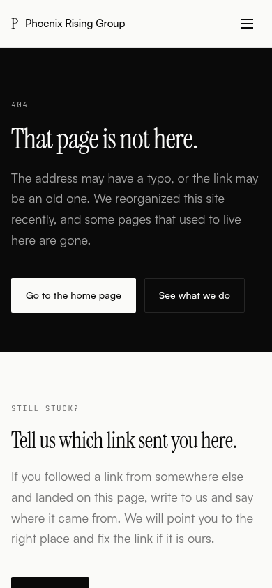 `docs/pr19-followup/after_404_html.png`
- 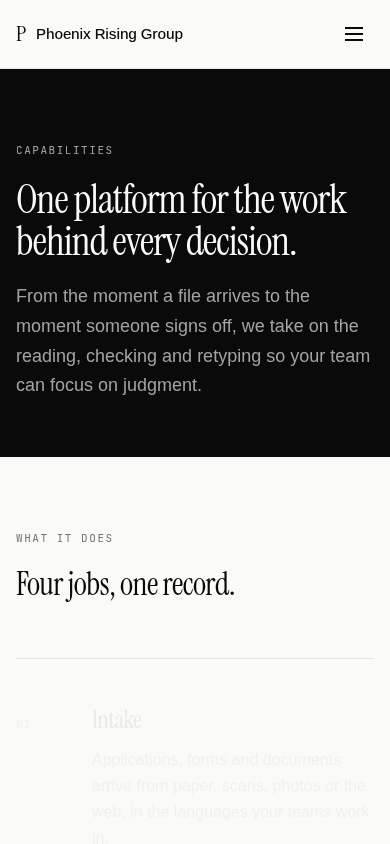 `docs/pr19-followup/after_capabilities_html.png`
- 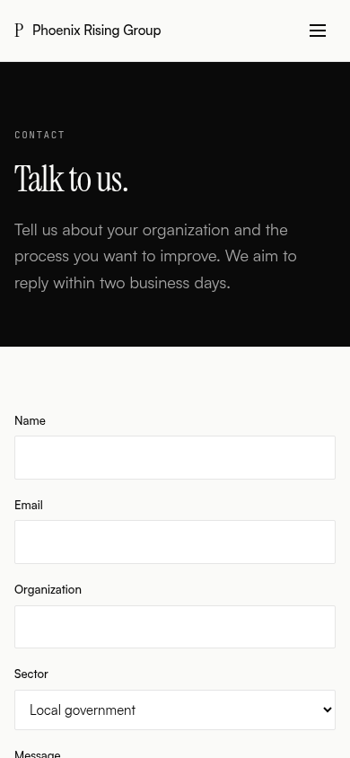 `docs/pr19-followup/after_contact_html.png`
- 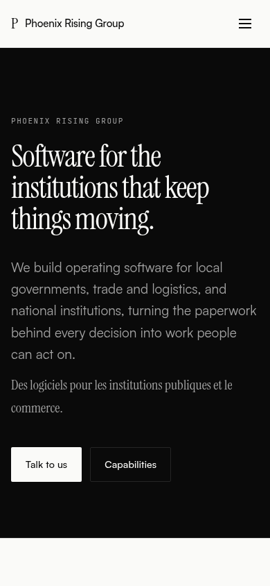 `docs/pr19-followup/after_index_html.png`
- 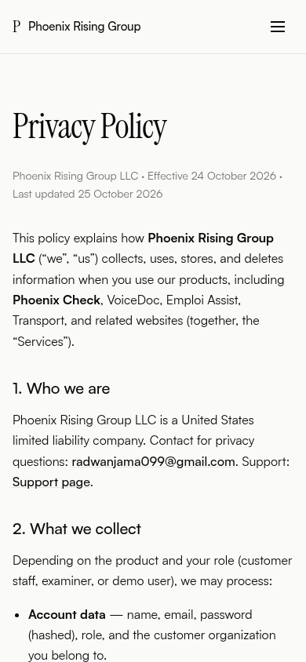 `docs/pr19-followup/after_privacy_html.png`
- 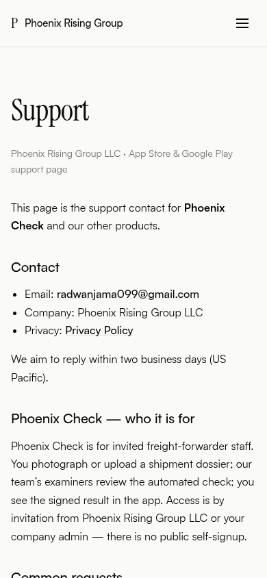 `docs/pr19-followup/after_support_html.png`
-  `docs/pr19-followup/before_blog_index_html.png`
- 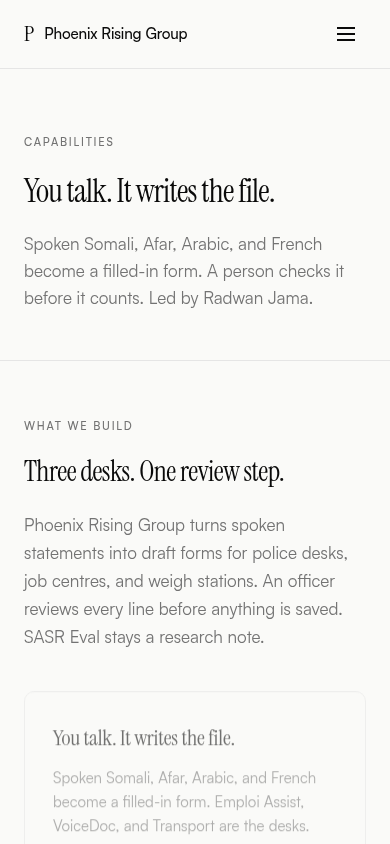 `docs/pr19-followup/before_capabilities_html.png`
- 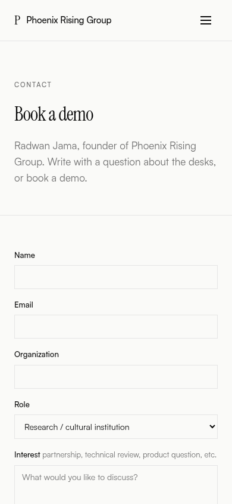 `docs/pr19-followup/before_contact_html.png`
- 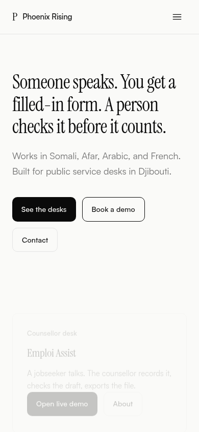 `docs/pr19-followup/before_index_html.png`
-  `docs/pr19-followup/before_privacy_html.png`
- 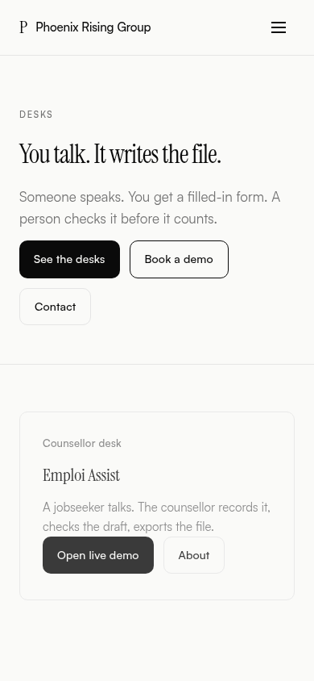 `docs/pr19-followup/before_products_index_html.png`
- 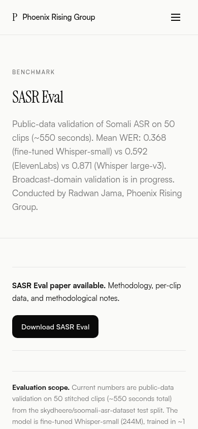 `docs/pr19-followup/before_results_html.png`
-  `docs/pr19-followup/before_support_html.png`

Redirect stubs (after) meta-refresh away, so they are covered by the test above rather than screenshots.

Untouched by design: support.html "our examiners" wording and share-image fonts (Radwan decides).
