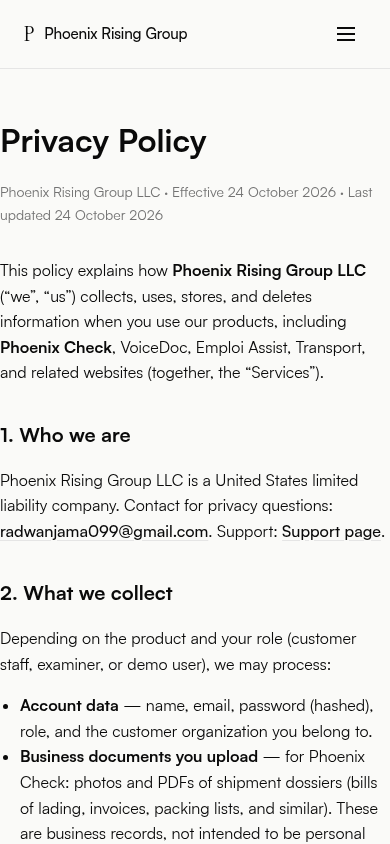
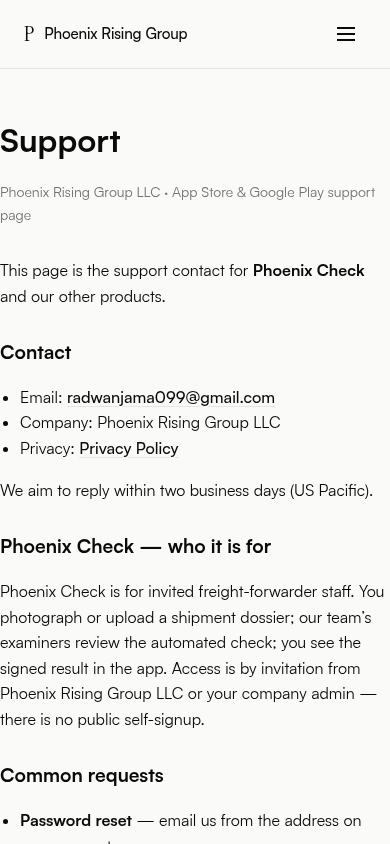
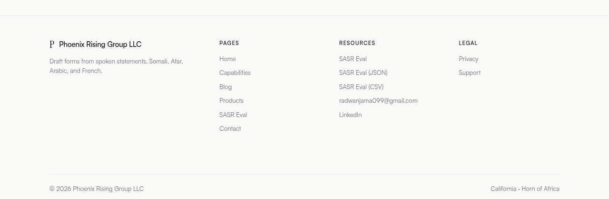

# TEST_PROOF — scripts/test_legal_pages.sh

Test-first evidence for the store-required legal pages. The contract test was written
**before** any page existed, run to confirm it fails, and run again after implementation to
confirm it passes.

Test file: [`scripts/test_legal_pages.sh`](scripts/test_legal_pages.sh) — 204 assertions
covering requirements (a) through (g) in [`PLAN.md`](PLAN.md). Every run below uses the
**final** version of that script, so the three results are directly comparable; the two RED
runs were reproduced in throwaway `git worktree` sandboxes checked out at the base commit
`9c6b1a1`, with only the stated files added.

> **2026-10-25 correction (CodeRabbit finding on PR #15, fixed in the
> `site/legal-test-hardening` follow-up):** the console blocks below originally showed
> `git worktree add --detach /tmp/red1-sandbox HEAD` / `...red2-sandbox HEAD`, contradicting
> the prose above, which always claimed base `9c6b1a1`. The commands now correctly show
> `9c6b1a1`, and both RED runs were **actually re-executed** in fresh worktrees at that
> commit, using the current (follow-up-fixed) version of `scripts/test_legal_pages.sh` —
> which is why the totals below read **228** rather than the original **204**: the follow-up
> added 17 footer-presence assertions (one per public page, see the dedicated section at the
> bottom of this file) on top of the 7 soft-fix assertions already folded in from the earlier
> PR #15 follow-up. The failure *counts* are otherwise unaffected by that growth — compare
> "2 of 2" and "137 of 228" below to the pre-correction "2 of 2" and "137 of 204".


---

## RED 1 — test written, nothing implemented

Base commit plus the test script alone. It fails at the first gate and short-circuits,
because every downstream assertion depends on the pages existing.

```console
$ git worktree add --detach /tmp/red1-sandbox 9c6b1a1
$ mkdir -p /tmp/red1-sandbox/scripts
$ cp scripts/test_legal_pages.sh /tmp/red1-sandbox/scripts/
$ cd /tmp/red1-sandbox && ./scripts/test_legal_pages.sh; echo "EXIT CODE: $?"
Preparing worktree (detached HEAD 9c6b1a1)
HEAD is now at 9c6b1a1 Site: VoiceDoc CTA to Book a demo (temp, demo login exposure) (#14)

== (a) new pages exist at repo root ==
FAIL privacy.html exists at repo root
FAIL support.html exists at repo root

2/2 checks failed (missing pages — remaining assertions skipped)
EXIT CODE: 1
```

**Result: FAIL (exit 1) — 2 of 2 checks failed.**

---

## RED 2 — new pages added, site-wide work not yet done

Base commit plus `privacy.html`, `support.html` and the test script — but **not** the
`sitemap.xml` entries, the 15 rewritten footers, or the `css/styles.css` grid change. This
run proves the test genuinely discriminates: the new pages pass their own chrome and content
assertions, while every unimplemented requirement is reported individually, per page, naming
the exact relative path it expected.

```console
$ git worktree add --detach /tmp/red2-sandbox 9c6b1a1
$ mkdir -p /tmp/red2-sandbox/scripts
$ cp scripts/test_legal_pages.sh /tmp/red2-sandbox/scripts/
$ cp privacy.html support.html /tmp/red2-sandbox/
$ cd /tmp/red2-sandbox && ./scripts/test_legal_pages.sh; echo "EXIT CODE: $?"
Preparing worktree (detached HEAD 9c6b1a1)
HEAD is now at 9c6b1a1 Site: VoiceDoc CTA to Book a demo (temp, demo login exposure) (#14)

== (a) new pages exist at repo root ==
ok   privacy.html exists at repo root
ok   support.html exists at repo root

== (b) seller name, support email, cross-links ==
ok   privacy.html states seller name 'Phoenix Rising Group LLC'
ok   privacy.html links mailto:radwanjama099@gmail.com
ok   support.html states seller name 'Phoenix Rising Group LLC'
ok   support.html links mailto:radwanjama099@gmail.com
ok   privacy.html links to support.html
ok   support.html links to privacy.html

== (c) shared chrome parity ==
ok   privacy.html loads css/styles.css
ok   privacy.html loads js/main.js
ok   privacy.html has site-header
ok   privacy.html has menu-toggle
ok   privacy.html has site-nav
ok   privacy.html site-nav offers 'Home'
ok   privacy.html site-nav offers 'Capabilities'
ok   privacy.html site-nav offers 'Blog'
ok   privacy.html site-nav offers 'Products'
ok   privacy.html site-nav offers 'Contact'
ok   privacy.html site-nav offers SASR Eval (results.html)
ok   privacy.html site-nav does not link Privacy/Support (keeps top nav uncrowded)
ok   privacy.html menu-toggle markup matches contact.html
ok   privacy.html font link tags match contact.html in content and order
ok   privacy.html declares charset UTF-8
ok   privacy.html is valid UTF-8
ok   support.html loads css/styles.css
ok   support.html loads js/main.js
ok   support.html has site-header
ok   support.html has menu-toggle
ok   support.html has site-nav
ok   support.html site-nav offers 'Home'
ok   support.html site-nav offers 'Capabilities'
ok   support.html site-nav offers 'Blog'
ok   support.html site-nav offers 'Products'
ok   support.html site-nav offers 'Contact'
ok   support.html site-nav offers SASR Eval (results.html)
ok   support.html site-nav does not link Privacy/Support (keeps top nav uncrowded)
ok   support.html menu-toggle markup matches contact.html
ok   support.html font link tags match contact.html in content and order
ok   support.html declares charset UTF-8
ok   support.html is valid UTF-8

== (d) sitemap.xml ==
FAIL sitemap.xml lists https://www.phoenixrisinggroups.com/privacy.html
FAIL sitemap.xml lists https://www.phoenixrisinggroups.com/support.html

== (e) footer presence and seller attribution across 17 public pages ==
ok   found 17 public pages to check
ok   blog/afar-language-speech-recognition/index.html has <footer class="site-footer">
ok   blog/djiboutian-somali-dialect-asr/index.html has <footer class="site-footer">
ok   blog/horn-of-africa-language-technology-gap/index.html has <footer class="site-footer">
ok   blog/index.html has <footer class="site-footer">
ok   blog/sasr-eval-somali-asr-benchmark/index.html has <footer class="site-footer">
ok   blog/why-commercial-asr-fails-on-somali/index.html has <footer class="site-footer">
ok   capabilities.html has <footer class="site-footer">
ok   contact.html has <footer class="site-footer">
ok   index.html has <footer class="site-footer">
ok   privacy.html has <footer class="site-footer">
ok   products/emploi-assist/index.html has <footer class="site-footer">
ok   products/horn-transcribe/index.html has <footer class="site-footer">
ok   products/index.html has <footer class="site-footer">
ok   products/transport/index.html has <footer class="site-footer">
ok   products/voicedoc-dnp/index.html has <footer class="site-footer">
ok   results.html has <footer class="site-footer">
ok   support.html has <footer class="site-footer">
FAIL blog/afar-language-speech-recognition/index.html footer-brand link text reads 'Phoenix Rising Group LLC'
FAIL blog/afar-language-speech-recognition/index.html &copy; line reads 'Phoenix Rising Group LLC'
FAIL blog/afar-language-speech-recognition/index.html footer has no bare 'Phoenix Rising' without 'Phoenix Rising Group LLC'
FAIL blog/djiboutian-somali-dialect-asr/index.html footer-brand link text reads 'Phoenix Rising Group LLC'
FAIL blog/djiboutian-somali-dialect-asr/index.html &copy; line reads 'Phoenix Rising Group LLC'
FAIL blog/djiboutian-somali-dialect-asr/index.html footer has no bare 'Phoenix Rising' without 'Phoenix Rising Group LLC'
FAIL blog/horn-of-africa-language-technology-gap/index.html footer-brand link text reads 'Phoenix Rising Group LLC'
FAIL blog/horn-of-africa-language-technology-gap/index.html &copy; line reads 'Phoenix Rising Group LLC'
FAIL blog/horn-of-africa-language-technology-gap/index.html footer has no bare 'Phoenix Rising' without 'Phoenix Rising Group LLC'
FAIL blog/index.html footer-brand link text reads 'Phoenix Rising Group LLC'
FAIL blog/index.html &copy; line reads 'Phoenix Rising Group LLC'
FAIL blog/index.html footer has no bare 'Phoenix Rising' without 'Phoenix Rising Group LLC'
FAIL blog/sasr-eval-somali-asr-benchmark/index.html footer-brand link text reads 'Phoenix Rising Group LLC'
FAIL blog/sasr-eval-somali-asr-benchmark/index.html &copy; line reads 'Phoenix Rising Group LLC'
FAIL blog/sasr-eval-somali-asr-benchmark/index.html footer has no bare 'Phoenix Rising' without 'Phoenix Rising Group LLC'
FAIL blog/why-commercial-asr-fails-on-somali/index.html footer-brand link text reads 'Phoenix Rising Group LLC'
FAIL blog/why-commercial-asr-fails-on-somali/index.html &copy; line reads 'Phoenix Rising Group LLC'
FAIL blog/why-commercial-asr-fails-on-somali/index.html footer has no bare 'Phoenix Rising' without 'Phoenix Rising Group LLC'
FAIL capabilities.html footer-brand link text reads 'Phoenix Rising Group LLC'
FAIL capabilities.html &copy; line reads 'Phoenix Rising Group LLC'
FAIL capabilities.html footer has no bare 'Phoenix Rising' without 'Phoenix Rising Group LLC'
FAIL contact.html footer-brand link text reads 'Phoenix Rising Group LLC'
FAIL contact.html &copy; line reads 'Phoenix Rising Group LLC'
FAIL contact.html footer has no bare 'Phoenix Rising' without 'Phoenix Rising Group LLC'
FAIL index.html footer-brand link text reads 'Phoenix Rising Group LLC'
FAIL index.html &copy; line reads 'Phoenix Rising Group LLC'
FAIL index.html footer has no bare 'Phoenix Rising' without 'Phoenix Rising Group LLC'
ok   privacy.html footer-brand link text reads 'Phoenix Rising Group LLC'
ok   privacy.html &copy; line reads 'Phoenix Rising Group LLC'
ok   privacy.html footer has no bare 'Phoenix Rising' without 'Phoenix Rising Group LLC'
FAIL products/emploi-assist/index.html footer-brand link text reads 'Phoenix Rising Group LLC'
FAIL products/emploi-assist/index.html &copy; line reads 'Phoenix Rising Group LLC'
FAIL products/emploi-assist/index.html footer has no bare 'Phoenix Rising' without 'Phoenix Rising Group LLC'
FAIL products/horn-transcribe/index.html footer-brand link text reads 'Phoenix Rising Group LLC'
FAIL products/horn-transcribe/index.html &copy; line reads 'Phoenix Rising Group LLC'
FAIL products/horn-transcribe/index.html footer has no bare 'Phoenix Rising' without 'Phoenix Rising Group LLC'
FAIL products/index.html footer-brand link text reads 'Phoenix Rising Group LLC'
FAIL products/index.html &copy; line reads 'Phoenix Rising Group LLC'
FAIL products/index.html footer has no bare 'Phoenix Rising' without 'Phoenix Rising Group LLC'
FAIL products/transport/index.html footer-brand link text reads 'Phoenix Rising Group LLC'
FAIL products/transport/index.html &copy; line reads 'Phoenix Rising Group LLC'
FAIL products/transport/index.html footer has no bare 'Phoenix Rising' without 'Phoenix Rising Group LLC'
FAIL products/voicedoc-dnp/index.html footer-brand link text reads 'Phoenix Rising Group LLC'
FAIL products/voicedoc-dnp/index.html &copy; line reads 'Phoenix Rising Group LLC'
FAIL products/voicedoc-dnp/index.html footer has no bare 'Phoenix Rising' without 'Phoenix Rising Group LLC'
FAIL results.html footer-brand link text reads 'Phoenix Rising Group LLC'
FAIL results.html &copy; line reads 'Phoenix Rising Group LLC'
FAIL results.html footer has no bare 'Phoenix Rising' without 'Phoenix Rising Group LLC'
ok   support.html footer-brand link text reads 'Phoenix Rising Group LLC'
ok   support.html &copy; line reads 'Phoenix Rising Group LLC'
ok   support.html footer has no bare 'Phoenix Rising' without 'Phoenix Rising Group LLC'

== (f) footer Legal column with depth-correct, resolvable links ==
FAIL blog/afar-language-speech-recognition/index.html footer has a Legal column
FAIL blog/afar-language-speech-recognition/index.html Legal column links privacy.html as '../../privacy.html'
FAIL blog/afar-language-speech-recognition/index.html shipped link '<missing>' resolves to an existing file
FAIL blog/afar-language-speech-recognition/index.html Legal column links support.html as '../../support.html'
FAIL blog/afar-language-speech-recognition/index.html shipped link '<missing>' resolves to an existing file
FAIL blog/djiboutian-somali-dialect-asr/index.html footer has a Legal column
FAIL blog/djiboutian-somali-dialect-asr/index.html Legal column links privacy.html as '../../privacy.html'
FAIL blog/djiboutian-somali-dialect-asr/index.html shipped link '<missing>' resolves to an existing file
FAIL blog/djiboutian-somali-dialect-asr/index.html Legal column links support.html as '../../support.html'
FAIL blog/djiboutian-somali-dialect-asr/index.html shipped link '<missing>' resolves to an existing file
FAIL blog/horn-of-africa-language-technology-gap/index.html footer has a Legal column
FAIL blog/horn-of-africa-language-technology-gap/index.html Legal column links privacy.html as '../../privacy.html'
FAIL blog/horn-of-africa-language-technology-gap/index.html shipped link '<missing>' resolves to an existing file
FAIL blog/horn-of-africa-language-technology-gap/index.html Legal column links support.html as '../../support.html'
FAIL blog/horn-of-africa-language-technology-gap/index.html shipped link '<missing>' resolves to an existing file
FAIL blog/index.html footer has a Legal column
FAIL blog/index.html Legal column links privacy.html as '../privacy.html'
FAIL blog/index.html shipped link '<missing>' resolves to an existing file
FAIL blog/index.html Legal column links support.html as '../support.html'
FAIL blog/index.html shipped link '<missing>' resolves to an existing file
FAIL blog/sasr-eval-somali-asr-benchmark/index.html footer has a Legal column
FAIL blog/sasr-eval-somali-asr-benchmark/index.html Legal column links privacy.html as '../../privacy.html'
FAIL blog/sasr-eval-somali-asr-benchmark/index.html shipped link '<missing>' resolves to an existing file
FAIL blog/sasr-eval-somali-asr-benchmark/index.html Legal column links support.html as '../../support.html'
FAIL blog/sasr-eval-somali-asr-benchmark/index.html shipped link '<missing>' resolves to an existing file
FAIL blog/why-commercial-asr-fails-on-somali/index.html footer has a Legal column
FAIL blog/why-commercial-asr-fails-on-somali/index.html Legal column links privacy.html as '../../privacy.html'
FAIL blog/why-commercial-asr-fails-on-somali/index.html shipped link '<missing>' resolves to an existing file
FAIL blog/why-commercial-asr-fails-on-somali/index.html Legal column links support.html as '../../support.html'
FAIL blog/why-commercial-asr-fails-on-somali/index.html shipped link '<missing>' resolves to an existing file
FAIL capabilities.html footer has a Legal column
FAIL capabilities.html Legal column links privacy.html as 'privacy.html'
FAIL capabilities.html shipped link '<missing>' resolves to an existing file
FAIL capabilities.html Legal column links support.html as 'support.html'
FAIL capabilities.html shipped link '<missing>' resolves to an existing file
FAIL contact.html footer has a Legal column
FAIL contact.html Legal column links privacy.html as 'privacy.html'
FAIL contact.html shipped link '<missing>' resolves to an existing file
FAIL contact.html Legal column links support.html as 'support.html'
FAIL contact.html shipped link '<missing>' resolves to an existing file
FAIL index.html footer has a Legal column
FAIL index.html Legal column links privacy.html as 'privacy.html'
FAIL index.html shipped link '<missing>' resolves to an existing file
FAIL index.html Legal column links support.html as 'support.html'
FAIL index.html shipped link '<missing>' resolves to an existing file
ok   privacy.html footer has a Legal column
ok   privacy.html Legal column links privacy.html as 'privacy.html'
ok   privacy.html shipped link 'privacy.html' resolves to an existing file
ok   privacy.html Legal column links support.html as 'support.html'
ok   privacy.html shipped link 'support.html' resolves to an existing file
FAIL products/emploi-assist/index.html footer has a Legal column
FAIL products/emploi-assist/index.html Legal column links privacy.html as '../../privacy.html'
FAIL products/emploi-assist/index.html shipped link '<missing>' resolves to an existing file
FAIL products/emploi-assist/index.html Legal column links support.html as '../../support.html'
FAIL products/emploi-assist/index.html shipped link '<missing>' resolves to an existing file
FAIL products/horn-transcribe/index.html footer has a Legal column
FAIL products/horn-transcribe/index.html Legal column links privacy.html as '../../privacy.html'
FAIL products/horn-transcribe/index.html shipped link '<missing>' resolves to an existing file
FAIL products/horn-transcribe/index.html Legal column links support.html as '../../support.html'
FAIL products/horn-transcribe/index.html shipped link '<missing>' resolves to an existing file
FAIL products/index.html footer has a Legal column
FAIL products/index.html Legal column links privacy.html as '../privacy.html'
FAIL products/index.html shipped link '<missing>' resolves to an existing file
FAIL products/index.html Legal column links support.html as '../support.html'
FAIL products/index.html shipped link '<missing>' resolves to an existing file
FAIL products/transport/index.html footer has a Legal column
FAIL products/transport/index.html Legal column links privacy.html as '../../privacy.html'
FAIL products/transport/index.html shipped link '<missing>' resolves to an existing file
FAIL products/transport/index.html Legal column links support.html as '../../support.html'
FAIL products/transport/index.html shipped link '<missing>' resolves to an existing file
FAIL products/voicedoc-dnp/index.html footer has a Legal column
FAIL products/voicedoc-dnp/index.html Legal column links privacy.html as '../../privacy.html'
FAIL products/voicedoc-dnp/index.html shipped link '<missing>' resolves to an existing file
FAIL products/voicedoc-dnp/index.html Legal column links support.html as '../../support.html'
FAIL products/voicedoc-dnp/index.html shipped link '<missing>' resolves to an existing file
FAIL results.html footer has a Legal column
FAIL results.html Legal column links privacy.html as 'privacy.html'
FAIL results.html shipped link '<missing>' resolves to an existing file
FAIL results.html Legal column links support.html as 'support.html'
FAIL results.html shipped link '<missing>' resolves to an existing file
ok   support.html footer has a Legal column
ok   support.html Legal column links privacy.html as 'privacy.html'
ok   support.html shipped link 'privacy.html' resolves to an existing file
ok   support.html Legal column links support.html as 'support.html'
ok   support.html shipped link 'support.html' resolves to an existing file

== (h) LLC confined to footer attribution on pre-existing pages ==
FAIL blog/afar-language-speech-recognition/index.html mentions LLC only as footer attribution (brand + copyright) — found 0 in footer of 0 total, expected 2 of 2
FAIL blog/djiboutian-somali-dialect-asr/index.html mentions LLC only as footer attribution (brand + copyright) — found 0 in footer of 0 total, expected 2 of 2
FAIL blog/horn-of-africa-language-technology-gap/index.html mentions LLC only as footer attribution (brand + copyright) — found 0 in footer of 0 total, expected 2 of 2
FAIL blog/index.html mentions LLC only as footer attribution (brand + copyright) — found 0 in footer of 0 total, expected 2 of 2
FAIL blog/sasr-eval-somali-asr-benchmark/index.html mentions LLC only as footer attribution (brand + copyright) — found 0 in footer of 0 total, expected 2 of 2
FAIL blog/why-commercial-asr-fails-on-somali/index.html mentions LLC only as footer attribution (brand + copyright) — found 0 in footer of 0 total, expected 2 of 2
FAIL capabilities.html mentions LLC only as footer attribution (brand + copyright) — found 0 in footer of 0 total, expected 2 of 2
FAIL contact.html mentions LLC only as footer attribution (brand + copyright) — found 0 in footer of 0 total, expected 2 of 2
FAIL index.html mentions LLC only as footer attribution (brand + copyright) — found 0 in footer of 0 total, expected 2 of 2
FAIL products/emploi-assist/index.html mentions LLC only as footer attribution (brand + copyright) — found 0 in footer of 0 total, expected 2 of 2
FAIL products/horn-transcribe/index.html mentions LLC only as footer attribution (brand + copyright) — found 0 in footer of 0 total, expected 2 of 2
FAIL products/index.html mentions LLC only as footer attribution (brand + copyright) — found 0 in footer of 0 total, expected 2 of 2
FAIL products/transport/index.html mentions LLC only as footer attribution (brand + copyright) — found 0 in footer of 0 total, expected 2 of 2
FAIL products/voicedoc-dnp/index.html mentions LLC only as footer attribution (brand + copyright) — found 0 in footer of 0 total, expected 2 of 2
FAIL results.html mentions LLC only as footer attribution (brand + copyright) — found 0 in footer of 0 total, expected 2 of 2

== (g) forbidden claims absent from the new pages ==
ok   privacy.html makes no numeric percentage claim
ok   privacy.html makes no accuracy claim
ok   privacy.html does not use the word 'pilot'
ok   privacy.html claims no ministry involvement
ok   privacy.html claims no government endorsement
ok   support.html makes no numeric percentage claim
ok   support.html makes no accuracy claim
ok   support.html does not use the word 'pilot'
ok   support.html claims no ministry involvement
ok   support.html claims no government endorsement

== (i) soft-fix: retention, AI/DPA, and security claims stay accurate ==
ok   privacy.html retention section mentions backups
ok   privacy.html states the backup retention window (7 days)
ok   privacy.html does not claim a signed zero-retention/DPA agreement as current fact
ok   privacy.html frames the ZDR/DPA requirement as a gate before real customer files
ok   privacy.html does not claim blanket organization-separated isolation
ok   privacy.html states the modest claim: customers see their own organization's data
ok   privacy.html does not promise deletion certificates as an unconditional guarantee

FAIL: 137 of 228 checks failed
EXIT CODE: 1
```

**Result: FAIL (exit 1) — 137 of 228 checks failed:** (d) both sitemap entries missing,
(e) the footer seller name still read `Phoenix Rising` / `Phoenix Rising Group` on all 15
existing pages (the footer tag itself is still present on every page at this base commit, so
all 17 new footer-*presence* checks pass — that's the correct behavior now covered by Fix 1
below), (f) no Legal column anywhere. Section (i) passes because this run copies in the
already-soft-fixed `privacy.html` from the current branch tip, not a pre-fix draft.

---

## GREEN — full implementation

After adding the sitemap entries, rewriting the 15 footers, widening the footer grid to four
columns, and adding the `.legal` link styling found during screenshot review.

```console
$ cd /workspace/codaintel.github.io
$ ./scripts/test_legal_pages.sh; echo "EXIT CODE: $?"

== (a) new pages exist at repo root ==
ok   privacy.html exists at repo root
ok   support.html exists at repo root

== (b) seller name, support email, cross-links ==
ok   privacy.html states seller name 'Phoenix Rising Group LLC'
ok   privacy.html links mailto:radwanjama099@gmail.com
ok   support.html states seller name 'Phoenix Rising Group LLC'
ok   support.html links mailto:radwanjama099@gmail.com
ok   privacy.html links to support.html
ok   support.html links to privacy.html

== (c) shared chrome parity ==
ok   privacy.html loads css/styles.css
ok   privacy.html loads js/main.js
ok   privacy.html has site-header
ok   privacy.html has menu-toggle
ok   privacy.html has site-nav
ok   privacy.html site-nav offers 'Home'
ok   privacy.html site-nav offers 'Capabilities'
ok   privacy.html site-nav offers 'Blog'
ok   privacy.html site-nav offers 'Products'
ok   privacy.html site-nav offers 'Contact'
ok   privacy.html site-nav offers SASR Eval (results.html)
ok   privacy.html site-nav does not link Privacy/Support (keeps top nav uncrowded)
ok   privacy.html menu-toggle markup matches contact.html
ok   privacy.html font link tags match contact.html in content and order
ok   privacy.html declares charset UTF-8
ok   privacy.html is valid UTF-8
ok   support.html loads css/styles.css
ok   support.html loads js/main.js
ok   support.html has site-header
ok   support.html has menu-toggle
ok   support.html has site-nav
ok   support.html site-nav offers 'Home'
ok   support.html site-nav offers 'Capabilities'
ok   support.html site-nav offers 'Blog'
ok   support.html site-nav offers 'Products'
ok   support.html site-nav offers 'Contact'
ok   support.html site-nav offers SASR Eval (results.html)
ok   support.html site-nav does not link Privacy/Support (keeps top nav uncrowded)
ok   support.html menu-toggle markup matches contact.html
ok   support.html font link tags match contact.html in content and order
ok   support.html declares charset UTF-8
ok   support.html is valid UTF-8

== (d) sitemap.xml ==
ok   sitemap.xml lists https://www.phoenixrisinggroups.com/privacy.html
ok   sitemap.xml lists https://www.phoenixrisinggroups.com/support.html

== (e) footer seller attribution across 17 public pages ==
ok   found 17 public pages with a site-footer
ok   blog/afar-language-speech-recognition/index.html footer-brand link text reads 'Phoenix Rising Group LLC'
ok   blog/afar-language-speech-recognition/index.html &copy; line reads 'Phoenix Rising Group LLC'
ok   blog/afar-language-speech-recognition/index.html footer has no bare 'Phoenix Rising' without 'Phoenix Rising Group LLC'
ok   blog/djiboutian-somali-dialect-asr/index.html footer-brand link text reads 'Phoenix Rising Group LLC'
ok   blog/djiboutian-somali-dialect-asr/index.html &copy; line reads 'Phoenix Rising Group LLC'
ok   blog/djiboutian-somali-dialect-asr/index.html footer has no bare 'Phoenix Rising' without 'Phoenix Rising Group LLC'
ok   blog/horn-of-africa-language-technology-gap/index.html footer-brand link text reads 'Phoenix Rising Group LLC'
ok   blog/horn-of-africa-language-technology-gap/index.html &copy; line reads 'Phoenix Rising Group LLC'
ok   blog/horn-of-africa-language-technology-gap/index.html footer has no bare 'Phoenix Rising' without 'Phoenix Rising Group LLC'
ok   blog/index.html footer-brand link text reads 'Phoenix Rising Group LLC'
ok   blog/index.html &copy; line reads 'Phoenix Rising Group LLC'
ok   blog/index.html footer has no bare 'Phoenix Rising' without 'Phoenix Rising Group LLC'
ok   blog/sasr-eval-somali-asr-benchmark/index.html footer-brand link text reads 'Phoenix Rising Group LLC'
ok   blog/sasr-eval-somali-asr-benchmark/index.html &copy; line reads 'Phoenix Rising Group LLC'
ok   blog/sasr-eval-somali-asr-benchmark/index.html footer has no bare 'Phoenix Rising' without 'Phoenix Rising Group LLC'
ok   blog/why-commercial-asr-fails-on-somali/index.html footer-brand link text reads 'Phoenix Rising Group LLC'
ok   blog/why-commercial-asr-fails-on-somali/index.html &copy; line reads 'Phoenix Rising Group LLC'
ok   blog/why-commercial-asr-fails-on-somali/index.html footer has no bare 'Phoenix Rising' without 'Phoenix Rising Group LLC'
ok   capabilities.html footer-brand link text reads 'Phoenix Rising Group LLC'
ok   capabilities.html &copy; line reads 'Phoenix Rising Group LLC'
ok   capabilities.html footer has no bare 'Phoenix Rising' without 'Phoenix Rising Group LLC'
ok   contact.html footer-brand link text reads 'Phoenix Rising Group LLC'
ok   contact.html &copy; line reads 'Phoenix Rising Group LLC'
ok   contact.html footer has no bare 'Phoenix Rising' without 'Phoenix Rising Group LLC'
ok   index.html footer-brand link text reads 'Phoenix Rising Group LLC'
ok   index.html &copy; line reads 'Phoenix Rising Group LLC'
ok   index.html footer has no bare 'Phoenix Rising' without 'Phoenix Rising Group LLC'
ok   privacy.html footer-brand link text reads 'Phoenix Rising Group LLC'
ok   privacy.html &copy; line reads 'Phoenix Rising Group LLC'
ok   privacy.html footer has no bare 'Phoenix Rising' without 'Phoenix Rising Group LLC'
ok   products/emploi-assist/index.html footer-brand link text reads 'Phoenix Rising Group LLC'
ok   products/emploi-assist/index.html &copy; line reads 'Phoenix Rising Group LLC'
ok   products/emploi-assist/index.html footer has no bare 'Phoenix Rising' without 'Phoenix Rising Group LLC'
ok   products/horn-transcribe/index.html footer-brand link text reads 'Phoenix Rising Group LLC'
ok   products/horn-transcribe/index.html &copy; line reads 'Phoenix Rising Group LLC'
ok   products/horn-transcribe/index.html footer has no bare 'Phoenix Rising' without 'Phoenix Rising Group LLC'
ok   products/index.html footer-brand link text reads 'Phoenix Rising Group LLC'
ok   products/index.html &copy; line reads 'Phoenix Rising Group LLC'
ok   products/index.html footer has no bare 'Phoenix Rising' without 'Phoenix Rising Group LLC'
ok   products/transport/index.html footer-brand link text reads 'Phoenix Rising Group LLC'
ok   products/transport/index.html &copy; line reads 'Phoenix Rising Group LLC'
ok   products/transport/index.html footer has no bare 'Phoenix Rising' without 'Phoenix Rising Group LLC'
ok   products/voicedoc-dnp/index.html footer-brand link text reads 'Phoenix Rising Group LLC'
ok   products/voicedoc-dnp/index.html &copy; line reads 'Phoenix Rising Group LLC'
ok   products/voicedoc-dnp/index.html footer has no bare 'Phoenix Rising' without 'Phoenix Rising Group LLC'
ok   results.html footer-brand link text reads 'Phoenix Rising Group LLC'
ok   results.html &copy; line reads 'Phoenix Rising Group LLC'
ok   results.html footer has no bare 'Phoenix Rising' without 'Phoenix Rising Group LLC'
ok   support.html footer-brand link text reads 'Phoenix Rising Group LLC'
ok   support.html &copy; line reads 'Phoenix Rising Group LLC'
ok   support.html footer has no bare 'Phoenix Rising' without 'Phoenix Rising Group LLC'

== (f) footer Legal column with depth-correct, resolvable links ==
ok   blog/afar-language-speech-recognition/index.html footer has a Legal column
ok   blog/afar-language-speech-recognition/index.html Legal column links privacy.html as '../../privacy.html'
ok   blog/afar-language-speech-recognition/index.html shipped link '../../privacy.html' resolves to an existing file
ok   blog/afar-language-speech-recognition/index.html Legal column links support.html as '../../support.html'
ok   blog/afar-language-speech-recognition/index.html shipped link '../../support.html' resolves to an existing file
ok   blog/djiboutian-somali-dialect-asr/index.html footer has a Legal column
ok   blog/djiboutian-somali-dialect-asr/index.html Legal column links privacy.html as '../../privacy.html'
ok   blog/djiboutian-somali-dialect-asr/index.html shipped link '../../privacy.html' resolves to an existing file
ok   blog/djiboutian-somali-dialect-asr/index.html Legal column links support.html as '../../support.html'
ok   blog/djiboutian-somali-dialect-asr/index.html shipped link '../../support.html' resolves to an existing file
ok   blog/horn-of-africa-language-technology-gap/index.html footer has a Legal column
ok   blog/horn-of-africa-language-technology-gap/index.html Legal column links privacy.html as '../../privacy.html'
ok   blog/horn-of-africa-language-technology-gap/index.html shipped link '../../privacy.html' resolves to an existing file
ok   blog/horn-of-africa-language-technology-gap/index.html Legal column links support.html as '../../support.html'
ok   blog/horn-of-africa-language-technology-gap/index.html shipped link '../../support.html' resolves to an existing file
ok   blog/index.html footer has a Legal column
ok   blog/index.html Legal column links privacy.html as '../privacy.html'
ok   blog/index.html shipped link '../privacy.html' resolves to an existing file
ok   blog/index.html Legal column links support.html as '../support.html'
ok   blog/index.html shipped link '../support.html' resolves to an existing file
ok   blog/sasr-eval-somali-asr-benchmark/index.html footer has a Legal column
ok   blog/sasr-eval-somali-asr-benchmark/index.html Legal column links privacy.html as '../../privacy.html'
ok   blog/sasr-eval-somali-asr-benchmark/index.html shipped link '../../privacy.html' resolves to an existing file
ok   blog/sasr-eval-somali-asr-benchmark/index.html Legal column links support.html as '../../support.html'
ok   blog/sasr-eval-somali-asr-benchmark/index.html shipped link '../../support.html' resolves to an existing file
ok   blog/why-commercial-asr-fails-on-somali/index.html footer has a Legal column
ok   blog/why-commercial-asr-fails-on-somali/index.html Legal column links privacy.html as '../../privacy.html'
ok   blog/why-commercial-asr-fails-on-somali/index.html shipped link '../../privacy.html' resolves to an existing file
ok   blog/why-commercial-asr-fails-on-somali/index.html Legal column links support.html as '../../support.html'
ok   blog/why-commercial-asr-fails-on-somali/index.html shipped link '../../support.html' resolves to an existing file
ok   capabilities.html footer has a Legal column
ok   capabilities.html Legal column links privacy.html as 'privacy.html'
ok   capabilities.html shipped link 'privacy.html' resolves to an existing file
ok   capabilities.html Legal column links support.html as 'support.html'
ok   capabilities.html shipped link 'support.html' resolves to an existing file
ok   contact.html footer has a Legal column
ok   contact.html Legal column links privacy.html as 'privacy.html'
ok   contact.html shipped link 'privacy.html' resolves to an existing file
ok   contact.html Legal column links support.html as 'support.html'
ok   contact.html shipped link 'support.html' resolves to an existing file
ok   index.html footer has a Legal column
ok   index.html Legal column links privacy.html as 'privacy.html'
ok   index.html shipped link 'privacy.html' resolves to an existing file
ok   index.html Legal column links support.html as 'support.html'
ok   index.html shipped link 'support.html' resolves to an existing file
ok   privacy.html footer has a Legal column
ok   privacy.html Legal column links privacy.html as 'privacy.html'
ok   privacy.html shipped link 'privacy.html' resolves to an existing file
ok   privacy.html Legal column links support.html as 'support.html'
ok   privacy.html shipped link 'support.html' resolves to an existing file
ok   products/emploi-assist/index.html footer has a Legal column
ok   products/emploi-assist/index.html Legal column links privacy.html as '../../privacy.html'
ok   products/emploi-assist/index.html shipped link '../../privacy.html' resolves to an existing file
ok   products/emploi-assist/index.html Legal column links support.html as '../../support.html'
ok   products/emploi-assist/index.html shipped link '../../support.html' resolves to an existing file
ok   products/horn-transcribe/index.html footer has a Legal column
ok   products/horn-transcribe/index.html Legal column links privacy.html as '../../privacy.html'
ok   products/horn-transcribe/index.html shipped link '../../privacy.html' resolves to an existing file
ok   products/horn-transcribe/index.html Legal column links support.html as '../../support.html'
ok   products/horn-transcribe/index.html shipped link '../../support.html' resolves to an existing file
ok   products/index.html footer has a Legal column
ok   products/index.html Legal column links privacy.html as '../privacy.html'
ok   products/index.html shipped link '../privacy.html' resolves to an existing file
ok   products/index.html Legal column links support.html as '../support.html'
ok   products/index.html shipped link '../support.html' resolves to an existing file
ok   products/transport/index.html footer has a Legal column
ok   products/transport/index.html Legal column links privacy.html as '../../privacy.html'
ok   products/transport/index.html shipped link '../../privacy.html' resolves to an existing file
ok   products/transport/index.html Legal column links support.html as '../../support.html'
ok   products/transport/index.html shipped link '../../support.html' resolves to an existing file
ok   products/voicedoc-dnp/index.html footer has a Legal column
ok   products/voicedoc-dnp/index.html Legal column links privacy.html as '../../privacy.html'
ok   products/voicedoc-dnp/index.html shipped link '../../privacy.html' resolves to an existing file
ok   products/voicedoc-dnp/index.html Legal column links support.html as '../../support.html'
ok   products/voicedoc-dnp/index.html shipped link '../../support.html' resolves to an existing file
ok   results.html footer has a Legal column
ok   results.html Legal column links privacy.html as 'privacy.html'
ok   results.html shipped link 'privacy.html' resolves to an existing file
ok   results.html Legal column links support.html as 'support.html'
ok   results.html shipped link 'support.html' resolves to an existing file
ok   support.html footer has a Legal column
ok   support.html Legal column links privacy.html as 'privacy.html'
ok   support.html shipped link 'privacy.html' resolves to an existing file
ok   support.html Legal column links support.html as 'support.html'
ok   support.html shipped link 'support.html' resolves to an existing file

== (h) LLC confined to footer attribution on pre-existing pages ==
ok   blog/afar-language-speech-recognition/index.html mentions LLC only as footer attribution (brand + copyright)
ok   blog/djiboutian-somali-dialect-asr/index.html mentions LLC only as footer attribution (brand + copyright)
ok   blog/horn-of-africa-language-technology-gap/index.html mentions LLC only as footer attribution (brand + copyright)
ok   blog/index.html mentions LLC only as footer attribution (brand + copyright)
ok   blog/sasr-eval-somali-asr-benchmark/index.html mentions LLC only as footer attribution (brand + copyright)
ok   blog/why-commercial-asr-fails-on-somali/index.html mentions LLC only as footer attribution (brand + copyright)
ok   capabilities.html mentions LLC only as footer attribution (brand + copyright)
ok   contact.html mentions LLC only as footer attribution (brand + copyright)
ok   index.html mentions LLC only as footer attribution (brand + copyright)
ok   products/emploi-assist/index.html mentions LLC only as footer attribution (brand + copyright)
ok   products/horn-transcribe/index.html mentions LLC only as footer attribution (brand + copyright)
ok   products/index.html mentions LLC only as footer attribution (brand + copyright)
ok   products/transport/index.html mentions LLC only as footer attribution (brand + copyright)
ok   products/voicedoc-dnp/index.html mentions LLC only as footer attribution (brand + copyright)
ok   results.html mentions LLC only as footer attribution (brand + copyright)

== (g) forbidden claims absent from the new pages ==
ok   privacy.html makes no numeric percentage claim
ok   privacy.html makes no accuracy claim
ok   privacy.html does not use the word 'pilot'
ok   privacy.html claims no ministry involvement
ok   privacy.html claims no government endorsement
ok   support.html makes no numeric percentage claim
ok   support.html makes no accuracy claim
ok   support.html does not use the word 'pilot'
ok   support.html claims no ministry involvement
ok   support.html claims no government endorsement

PASS: 204/204 checks passed
EXIT CODE: 0
```

**Result: PASS (exit 0) — 204 of 204 checks passed.**

---

## Mutation testing — does the test fail when it should?

A green suite only means something if it goes red on a real regression. Five mutations were
applied to a throwaway copy of the finished tree and the suite re-run each time. All five
were caught:

| # | Mutation | Caught by |
| --- | --- | --- |
| 1 | Revert one page's copyright to bare `Phoenix Rising Group` | `products/transport/index.html &copy; line reads 'Phoenix Rising Group LLC'` + the bare-name guard |
| 2 | Change a nested blog post's Legal link from `../../privacy.html` to `../privacy.html` | `Legal column links privacy.html as '../../privacy.html'` **and** `shipped link '../privacy.html' resolves to an existing file` |
| 3 | Add a `Privacy` item to the top nav of `privacy.html` | `site-nav does not link Privacy/Support (keeps top nav uncrowded)` |
| 4 | Insert *"Our checks reach 98% accuracy in ministry pilot deployments."* into `support.html` | all four of the percentage, accuracy, `pilot` and ministry guards |
| 5 | Leak `LLC` into `capabilities.html`'s `og:site_name` | `capabilities.html mentions LLC only as footer attribution (brand + copyright) — found 2 in footer of 3 total, expected 2 of 2` |

Mutation 2 is the reason section (f) carries two assertions per link rather than one. The
first checks the page ships the depth-correct href; the second resolves **the href the page
actually ships** against the filesystem. An earlier draft resolved the *expected* path
instead, which made the second assertion tautological — mutation 2 exposed that, and the
assertion was rewritten before this proof was recorded.

Mutation 5 is why section (h) exists at all. The original suite only inspected markup
*inside* the footer, so it could not have caught the entity name leaking into a `<title>`,
`<h1>`, meta or `og:*` tag — the one constraint the whole brand-scope rule rests on. The gap
was raised by code review, section (h) was added, and mutation 5 confirms it now fails
loudly. See [`REVIEW.md`](REVIEW.md).

---

## Phone-size screenshots (390 × 844)

Captured against a local static server with headless Chrome 155, at the iPhone 12/13/14
logical viewport:

```console
$ python3 -m http.server 8777 --bind 127.0.0.1 &
$ google-chrome --headless --disable-gpu --no-sandbox --hide-scrollbars \
    --window-size=390,844 \
    --screenshot=/workspace/site-legal-ecc/privacy-phone.png \
    http://127.0.0.1:8777/privacy.html
$ google-chrome --headless --disable-gpu --no-sandbox --hide-scrollbars \
    --window-size=390,844 \
    --screenshot=/workspace/site-legal-ecc/support-phone.png \
    http://127.0.0.1:8777/support.html
$ cp /workspace/site-legal-ecc/{privacy,support}-phone.png docs/legal-screenshots/
```

| Page | Screenshot |
| --- | --- |
| `privacy.html` | [`docs/legal-screenshots/privacy-phone.png`](docs/legal-screenshots/privacy-phone.png) |
| `support.html` | [`docs/legal-screenshots/support-phone.png`](docs/legal-screenshots/support-phone.png) |





Both confirm: Satoshi / Instrument Serif load, the header brand reads **Phoenix Rising
Group** without `LLC`, the hamburger `menu-toggle` appears at the ≤760px breakpoint, and the
curly quotes and em dashes in the legal body render correctly (UTF-8 intact).

The first capture surfaced a real defect — inline links in the legal prose were
indistinguishable from body text, because the site-wide `a` rule sets
`text-decoration: none`. Fixed by reusing the site's existing prose-link idiom
(`.research-footnote a` / `.eval-note a` in `css/styles.css`) inside the `.legal` scope. The
screenshots above are the post-fix renders — `radwanjama099@gmail.com` and `Privacy Policy`
are now visibly underlined.

### Footer Legal column

The footer change is the bulk of the diff, so it gets its own render — the `index.html`
footer at 1280px, showing the four-column layout, the new `LEGAL` column, and the seller
attribution in both the brand link and the copyright line:



At ≤900px the pre-existing `.site-footer .wrap { grid-template-columns: 1fr; }` rule
collapses all four columns to a single stack, verified in the 390px-wide capture of
`index.html`; no new breakpoint was needed.

---

## Supplementary mechanical checks

Run alongside the contract test; all clean. Commands and detail in [`REVIEW.md`](REVIEW.md).

| Check | Result |
| --- | --- |
| `LLC` appearing outside the footer on any of the 15 pre-existing pages | none |
| Invalid UTF-8 or U+FFFD replacement characters anywhere in the repo | none |
| French accented characters in `index.html`, `products/index.html`, `products/transport/index.html` | byte-count identical to `HEAD` |
| Local `href`/`src` on the new pages that do not resolve on disk | none |
| Footer Legal links across all 17 pages that do not resolve | none |
| HTML tag-balance errors in the new pages (`html.parser`) | none |
| `target="_blank"` without `rel="noopener"` on the new pages | none |
| Inline `<script>`, `javascript:` URL, or `on*=` handler on the new pages | none |
| `sitemap.xml` well-formed XML (`xml.dom.minidom.parse`) | pass |
| Credential-shaped strings in changed/new files | none |

---

## Follow-up — soft-fix privacy copy overclaims (PR #15, no merge)

Three new assertion groups added to section (i) of `scripts/test_legal_pages.sh`, written
against the pre-fix copy of `privacy.html` first (RED), then re-run after the edit (GREEN).
Suite grew from 204 to 211 assertions.

### RED — assertions written before the copy was fixed

```console
$ ./scripts/test_legal_pages.sh
...
== (i) soft-fix: retention, AI/DPA, and security claims stay accurate ==
FAIL privacy.html retention section mentions backups
FAIL privacy.html states the backup retention window (7 days)
ok   privacy.html does not claim a signed zero-retention/DPA agreement as current fact
FAIL privacy.html frames the ZDR/DPA requirement as a gate before real customer files
FAIL privacy.html does not claim blanket organization-separated isolation
ok   privacy.html states the modest claim: customers see their own organization's data
ok   privacy.html does not promise deletion certificates as an unconditional guarantee

FAIL: 4 of 211 checks failed
```

**Result: FAIL — 4 of 211 checks failed**, all in the new section; the pre-existing 204
assertions stayed green. The three passing checks in this section were already true of the
old copy (no present-tense "signed" claim, no unconditional-guarantee phrasing), confirming
the new assertions discriminate rather than trivially passing.

### Intermediate catch — the fix itself tripped its own negative-claim guard

The first wording for §4 ("not a statement that every provider agreement is already
signed") contains the literal substring "already signed" inside a negation, which the
naive `grep` guard can't distinguish from an actual overclaim:

```console
FAIL privacy.html does not claim a signed zero-retention/DPA agreement as current fact
PASS: 210/211 checks passed
```

Reworded to avoid the ambiguous phrase entirely ("not a claim that it is in place for every
provider today") rather than special-casing the regex — the copy itself should not read as
ambiguous to a human either.

### GREEN — full suite after the soft-fix

```console
$ ./scripts/test_legal_pages.sh
...
== (i) soft-fix: retention, AI/DPA, and security claims stay accurate ==
ok   privacy.html retention section mentions backups
ok   privacy.html states the backup retention window (7 days)
ok   privacy.html does not claim a signed zero-retention/DPA agreement as current fact
ok   privacy.html frames the ZDR/DPA requirement as a gate before real customer files
ok   privacy.html does not claim blanket organization-separated isolation
ok   privacy.html states the modest claim: customers see their own organization's data
ok   privacy.html does not promise deletion certificates as an unconditional guarantee

PASS: 211/211 checks passed
```

**Result: PASS (exit 0) — 211 of 211 checks passed.** All 204 pre-existing assertions remain
green; the 7 new assertions confirm the soft-fix wording.

---

## Follow-up — test hardening (branch `site/legal-test-hardening`, no merge)

**This section is the source of truth for the current PR.** It fixes two CodeRabbit findings
left open after PR #15 (`90a2f7b`, squashed to `main`): (1) `collect_footer_pages` silently
dropped any public page missing its footer instead of failing the suite, and (2) the RED
reproduction commands above showed `HEAD` instead of the base commit `9c6b1a1` they claimed
to use — already fixed in place above. This section covers Fix 1 end-to-end: the bug as it
existed, the fix, and mutation proof that it now fails loudly.

Suite grew from 211 to **228** assertions (17 new footer-presence checks, one per public
page). All 211 pre-existing assertions stay green throughout.

### Bug demo — the pre-fix script on the current branch tip

Before changing the script, a scratch `git worktree` at `HEAD` (`90a2f7b`, i.e. current
`main`) had one public page's `<footer>` block stripped entirely, to show the **pre-fix**
`collect_footer_pages` silently drops it instead of failing:

```console
$ git worktree add --detach /tmp/bugdemo-sandbox HEAD
Preparing worktree (detached HEAD 90a2f7b)
$ cd /tmp/bugdemo-sandbox
$ python3 -c "... strip <footer class=\"site-footer\">...</footer> from results.html ..."
$ grep -c 'site-footer' results.html
0
$ ./scripts/test_legal_pages.sh; echo "EXIT CODE: $?"
...
ok   found 16 public pages with a site-footer
...
PASS: 202/202 checks passed
EXIT CODE: 0
```

**Confirmed bug:** `results.html` has zero occurrences of `site-footer` (verified by the
`grep -c` above), yet the suite reports `PASS: 202/202` and silently drops the page count
from 17 to 16 — no `FAIL` anywhere names `results.html`. This is the silent-skip CodeRabbit
flagged.

### Fix 1 implementation

`scripts/test_legal_pages.sh`:
- `collect_footer_pages()` (filtered to pages that already had the footer) renamed to
  `collect_public_pages()`, which now enumerates **every** `*.html` except `.git/*` and
  `google*.html` — unconditionally, with no footer pre-filter.
- Section (e) now asserts, for every page in that full set, that it has
  `<footer class="site-footer">` — a missing footer is a named `FAIL`, not an omission.
- Sections (e)'s seller-attribution checks, (f)'s Legal-column checks, and (h)'s LLC-scope
  checks all now iterate the same full `public_pages` set (renamed from `footer_pages`)
  instead of a pre-filtered "already has footer" subset.

### RED — mutation proof that a missing footer now fails, naming the page

A scratch copy of the fixed branch tip (`cp -r`, excluding `.git`) was confirmed green first,
then `products/transport/index.html`'s `<footer>` block was stripped and the suite re-run:

```console
$ ./scripts/test_legal_pages.sh   # before mutation
...
PASS: 228/228 checks passed

$ python3 -c "... strip <footer class=\"site-footer\">...</footer> from products/transport/index.html ..."
$ grep -c 'site-footer' products/transport/index.html
0

$ ./scripts/test_legal_pages.sh; echo "EXIT CODE: $?"
...
FAIL products/transport/index.html has <footer class="site-footer">
FAIL products/transport/index.html footer-brand link text reads 'Phoenix Rising Group LLC'
FAIL products/transport/index.html &copy; line reads 'Phoenix Rising Group LLC'
ok   products/transport/index.html footer has no bare 'Phoenix Rising' without 'Phoenix Rising Group LLC'
FAIL products/transport/index.html footer has a Legal column
FAIL products/transport/index.html Legal column links privacy.html as '../../privacy.html'
FAIL products/transport/index.html shipped link '<missing>' resolves to an existing file
FAIL products/transport/index.html Legal column links support.html as '../../support.html'
FAIL products/transport/index.html shipped link '<missing>' resolves to an existing file
FAIL products/transport/index.html mentions LLC only as footer attribution (brand + copyright) — found 0 in footer of 0 total, expected 2 of 2

FAIL: 9 of 228 checks failed
EXIT CODE: 1
```

**Result: FAIL (exit 1) — 9 of 228 checks failed, every one naming
`products/transport/index.html`.** The first failure is the new footer-presence assertion
itself; the other 8 are the pre-existing seller/Legal-column/LLC checks correctly cascading
once the footer is gone, instead of being silently skipped as before.

### GREEN — restore and re-run

```console
$ cp /workspace/codaintel.github.io/products/transport/index.html products/transport/index.html
$ ./scripts/test_legal_pages.sh; echo "EXIT CODE: $?"
...
PASS: 228/228 checks passed
EXIT CODE: 0
```

### Mutation table addendum

| # | Mutation | Caught by |
| --- | --- | --- |
| 6 | Strip `<footer class="site-footer">…</footer>` entirely from `products/transport/index.html` | `products/transport/index.html has <footer class="site-footer">` (new), plus the 8 cascading seller/Legal-column/LLC failures that would previously have been silently skipped |

### GREEN — full suite on this branch's tip

```console
$ cd /workspace/codaintel.github.io
$ ./scripts/test_legal_pages.sh; echo "EXIT CODE: $?"
...
== (e) footer presence and seller attribution across 17 public pages ==
ok   found 17 public pages to check
ok   blog/afar-language-speech-recognition/index.html has <footer class="site-footer">
ok   blog/djiboutian-somali-dialect-asr/index.html has <footer class="site-footer">
ok   blog/horn-of-africa-language-technology-gap/index.html has <footer class="site-footer">
ok   blog/index.html has <footer class="site-footer">
ok   blog/sasr-eval-somali-asr-benchmark/index.html has <footer class="site-footer">
ok   blog/why-commercial-asr-fails-on-somali/index.html has <footer class="site-footer">
ok   capabilities.html has <footer class="site-footer">
ok   contact.html has <footer class="site-footer">
ok   index.html has <footer class="site-footer">
ok   privacy.html has <footer class="site-footer">
ok   products/emploi-assist/index.html has <footer class="site-footer">
ok   products/horn-transcribe/index.html has <footer class="site-footer">
ok   products/index.html has <footer class="site-footer">
ok   products/transport/index.html has <footer class="site-footer">
ok   products/voicedoc-dnp/index.html has <footer class="site-footer">
ok   results.html has <footer class="site-footer">
ok   support.html has <footer class="site-footer">
...
PASS: 228/228 checks passed
EXIT CODE: 0
```

**Result: PASS (exit 0) — 228 of 228 checks passed** (up from 211; +17 new footer-presence
assertions, 0 regressions).

### Red→green summary for this PR

| Run | Base / tree | Script assertions | Result |
| --- | --- | --- | --- |
| Historical RED 1 (corrected) | worktree @ `9c6b1a1`, script only | 228 total, bails at (a) | FAIL — 2/2 checks failed, exit 1 |
| Historical RED 2 (corrected) | worktree @ `9c6b1a1`, + `privacy.html`/`support.html` | 228 | FAIL — 137/228 checks failed, exit 1 |
| Bug demo (pre-fix script, `HEAD`=`90a2f7b`, footer stripped from `results.html`) | worktree @ `HEAD` | 202 (pre-fix script) | **Bug confirmed:** PASS 202/202 — page silently dropped, no FAIL |
| Fix 1 mutation RED (scratch `cp -r` of branch tip, footer stripped from `products/transport/index.html`) | branch tip | 228 | FAIL — 9/228 checks failed, naming the page, exit 1 |
| Fix 1 mutation GREEN (restored) | branch tip | 228 | PASS — 228/228, exit 0 |
| Branch tip GREEN | `site/legal-test-hardening` HEAD | 228 | PASS — 228/228, exit 0 |

**Note on methodology:** the two historical RED reproductions above use worktrees genuinely
checked out at base `9c6b1a1` (the Fix 2 correction), run with the current, Fix-1-updated
script — not the script version that was contemporary with `9c6b1a1`. The new
missing-footer RED (Fix 1's own proof) instead uses a plain scratch copy (`cp -r`, no `.git`)
of the current branch tip with one page's footer removed, since that fix is about behavior
on the *current* tree, not about reproducing a historical base state. Both methods are
documented inline above so the base/script pairing used for each run is unambiguous.

---

# TEST_PROOF — CI workflow for the legal-pages contract test

Change: add `.github/workflows/ci.yml` running `scripts/test_legal_pages.sh`.
Branch: `ci/legal-pages-workflow` (base `main` @ 90a2f7b).

Appended rather than rewritten so the Design & Site follow-up on `TEST_PROOF.md`
(CodeRabbit: red steps) merges without conflict.

What is under test here is the **CI wiring**, not the legal pages. The contract script
already passes on `main`; what was missing is anything that runs it. So the red step proves
the absence of that automation, and the green steps prove a workflow now invokes it, that
the script still passes, and that a regression would actually turn the job red.

## RED — before the change: no workflow runs the contract test

Run in a clean worktree at base `main` @ 90a2f7b with `.github/` untouched.

```console
$ ls -1 .github/workflows/
static.yml

$ grep -rn "test_legal_pages" .github/ ; echo "exit=$?"
exit=1

$ grep -rln "scripts/" .github/workflows/ ; echo "exit=$?"
exit=1

$ grep -n "uses:\|run:" .github/workflows/static.yml
33:        uses: actions/checkout@v4
35:        uses: actions/configure-pages@v5
37:        uses: actions/upload-pages-artifact@v3
43:        uses: actions/deploy-pages@v5
```

Reading those four results:

1. The only workflow in the repo is `static.yml`, the GitHub Pages deploy.
2. `grep` exits **1** (no lines selected) for `test_legal_pages` anywhere under
   `.github/` — nothing references the contract test.
3. `grep` exits **1** for `scripts/` across all workflow files — no workflow runs *any*
   repo script, so the gap is not hidden behind an indirect invocation.
4. `static.yml` has no `run:` step at all: its four steps are checkout, configure-pages,
   upload-pages-artifact, deploy-pages. It deploys; it never tests.

**Red conclusion:** a change breaking the store-required privacy/support pages or the
footer seller attribution would deploy to Pages with no check objecting. That is the
defect this PR fixes.

## GREEN — after adding `.github/workflows/ci.yml`

### 1. A workflow now invokes the contract test

The grep that exited 1 above now matches — line 3 is the header comment, line 38 the step
that runs it:

```console
$ grep -rn "test_legal_pages" .github/workflows/ci.yml
3:# Runs scripts/test_legal_pages.sh, which asserts the store-required privacy and support
38:        run: bash scripts/test_legal_pages.sh
```

### 2. `ci.yml` is valid YAML with the intended shape

```console
$ python3 -c "import yaml; d = yaml.safe_load(open('.github/workflows/ci.yml')); ..."
name:         CI
triggers:     ['pull_request', 'push', 'workflow_dispatch']
push:         {'branches': ['main']}
permissions:  {'contents': 'read'}
concurrency:  {'group': '${{ github.workflow }}-${{ github.ref }}', 'cancel-in-progress': True}
job:          legal-pages | runs-on: ubuntu-latest
  step:       actions/checkout@v4
  step:       bash scripts/test_legal_pages.sh
```

All three required triggers are present, the only permission is `contents: read`, and the
job is two steps: checkout, then the script. (`actionlint` is not installed in this
environment, so validation is the YAML parse plus the shape assertions above.)

### 3. No secrets, no write permissions, no skip switch

```console
$ grep -nE "secrets\.|GITHUB_TOKEN|id-token|^[[:space:]]+pages:|continue-on-error" \
    .github/workflows/ci.yml ; echo "exit=$?"
exit=1
```

grep exits 1: `ci.yml` references no secret and no token, grants neither Pages-deploy
permission, and has no `continue-on-error` that could mask a failure.

### 4. `static.yml` is untouched

```console
$ git diff --stat main...HEAD -- .github/workflows/static.yml ; echo "exit=$?"
exit=0
```

Empty diff — the Pages deploy workflow is unchanged by this branch.

### 5. The contract test still passes locally (211/211)

```console
$ bash scripts/test_legal_pages.sh ; echo "exit=$?"
...
ok   privacy.html states the modest claim: customers see their own organization's data
ok   privacy.html does not promise deletion certificates as an unconditional guarantee

PASS: 211/211 checks passed
exit=0
```

### 6. The job would actually go red on a regression

A passing job proves nothing unless failure propagates. Mutating the footer seller
attribution in `privacy.html` (`Phoenix Rising Group LLC` → `Phoenix Rising Group`) and
re-running:

```console
$ sed -i 's/Phoenix Rising Group LLC/Phoenix Rising Group/g' privacy.html
$ bash scripts/test_legal_pages.sh ; echo "exit=$?"
FAIL: 4 of 211 checks failed
exit=1

$ git checkout privacy.html   # mutation reverted
$ bash scripts/test_legal_pages.sh | tail -1
PASS: 211/211 checks passed
```

Non-zero exit from the `run:` step fails the step, and with no `continue-on-error` that
fails the job and the check. The mutation was reverted; `privacy.html` is byte-identical to
`main` on this branch.

## What runs on GitHub after push

Pushing this branch and opening the PR triggers `ci.yml` through its `pull_request` event:
the `legal-pages` job checks the repo out and runs `bash scripts/test_legal_pages.sh`. The
run appears in the PR's checks tab and under the workflow name **CI** in the Actions tab.
After merge the same workflow runs on every `push` to `main`, and can be started by hand
from the Actions tab via `workflow_dispatch`.

Making this check *required* for merge is deliberately left to the repo owner in GitHub
branch-protection settings; this PR does not configure it.

### Confirmed green on GitHub Actions

Run [40177348062](https://github.com/RadwanJama01/codaintel.github.io/actions/runs/40177348062),
triggered by the `pull_request` event on PR #16 (head `d2358f1`):

```console
$ gh run view 40177348062 --json conclusion,event,jobs
conclusion: success
event:      pull_request
job "Legal pages contract test": success
  Set up job                      success
  Checkout                        success
  Run legal-pages contract test   success
  Post Checkout                   success
  Complete job                    success

$ gh run view 40177348062 --log | grep -E "PASS:|FAIL:"
Run legal-pages contract test  PASS: 211/211 checks passed
```

Same 211/211 as locally, in 5 seconds, with no deployment step. One advisory warning from
the runner, not a failure:

```
##[warning]Node.js 20 is deprecated. The following actions target Node.js 20 but are
being forced to run on Node.js 24: actions/checkout@v4.
```

`actions/checkout@v5` is the version that targets Node 24. This branch deliberately stays
on `@v4` to match `static.yml`; bumping both workflows together is the right follow-up, and
until then GitHub runs `@v4` on Node 24 anyway.
